# BombLab 实验报告

---

## Phase 1

**运行结果：**

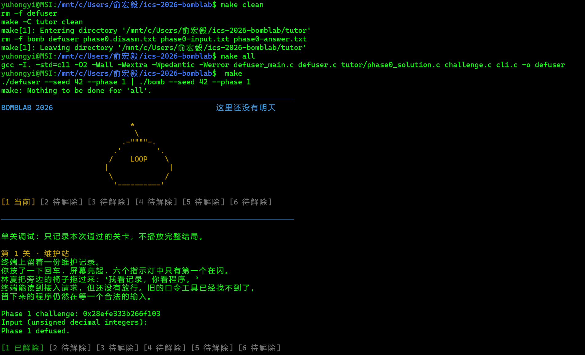

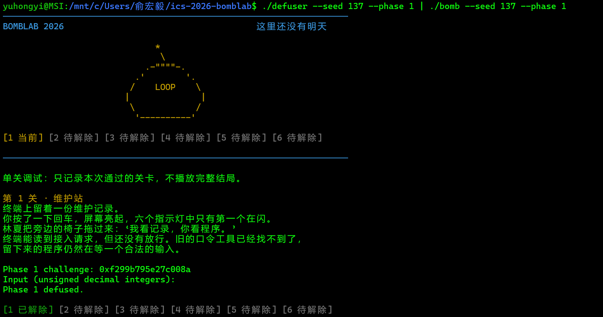

**推理：**

```asm
1.  402028:	push   %r12   //把r12原有的内容压入栈，结束后要复原
    40202a:	mov    %rsi,%r12    //rsi中的challenge存入r12
    40202d:	mov    $0x1,%esi    //esi存整数1     
    402032:	push   %rbx 
    402033:	mov    %rdi,%rbx    //rdi中输入字符串地址存入rbx
2.  40203a:	call   402c10 <valid_u32_fields> //验证输入的字符串是否符合格式要求
3.  402043:	add    $0x10,%rsp
    402047:	xor    %eax,%eax
    402049:	pop    %rbx
    40204a:	pop    %r12
    40204c:	pop    %rbp
    40204d:	ret
    //失败时退出，后续过程中失败均跳转至这一步
4.  402052:	lea    -0x14(%rbp),%rdx
    402056:	mov    $0x403182,%esi
    40205b:	mov    %rbx,%rdi
    40205e:	call   4011e0 <__isoc99_sscanf@plt>
    402063:	cmp    $0x1,%eax
    402066:	jne    402043 <phase_01+0x23>
    //用<__isoc99_sscanf@plt>检验可识别的字符串是否是一个，假如不是跳转到402043退出
5.  到p1_compute中：
    0x0000000000401fe5 <+5>:     mov    %rdi,%rdx
    0x0000000000401fe8 <+8>:     mov    %rdi,%rax
    0x0000000000401feb <+11>:    shr    $0x20,%rax
    0x0000000000401fef <+15>:    mov    %rdx,%rsi
    0x0000000000401ff2 <+18>:    mov    %eax,%edi
    0x0000000000401ff4 <+20>:    shr    $0x10,%rsi
    //rdx,rax,rsi均存入challenge，然后rax>>32，rsi>>16,又rax赋值到rdi,对应defuser.c中rax,rdi--high32;rdx--low32;rsi--shr16

    p1_step1:   //s1 = (shr16 + 0xf6b7) ^ high32;
    0x0000000000401fc4 <+4>:     lea    0xf6b7(%rsi),%eax
    0x0000000000401fca <+10>:    xor    %edi,%eax

    p1_step0:   //s0 = (low32 + 2 * high32) ^ 0xe190;
    0x0000000000401fb4 <+4>:     lea    (%rdi,%rsi,2),%eax
    0x0000000000401fb7 <+7>:     xor    $0xe190,%eax

    p1_step2:   //s2 = (s0 * 5 + s1) ^ 0xcebf;
    0x0000000000401fd4 <+4>:     lea    (%rdi,%rdi,4),%eax
    0x0000000000401fd7 <+7>:     add    %esi,%eax
    0x0000000000401fd9 <+9>:     xor    $0xcebf,%eax
6.  最后取s2放入values[0],count=1只输出一个数字
```

---

## Phase 2

**运行结果：**

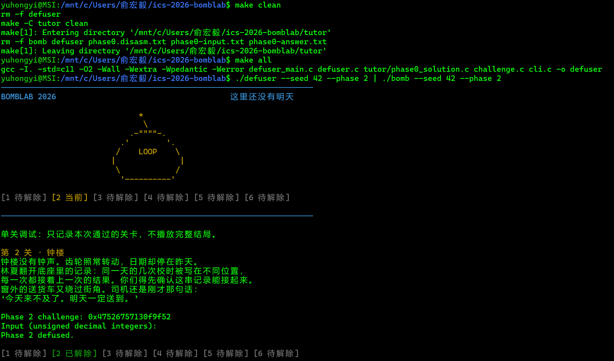

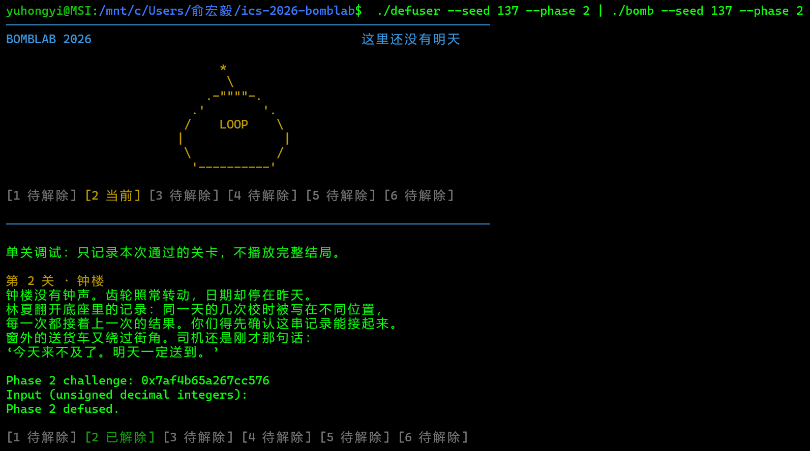

**推理：**

```asm
1.  //rsi(challenge)存入r13,rdi(*out)存入r12,6u存入esi
    402088:	push   %r13
    40208a:	mov    %rsi,%r13
    40208d:	mov    $0x6,%esi
    402092:	push   %r12
    402094:	mov    %rdi,%r12
    //<valid_u32_fields>检验格式
3.  4020ba:	lea    -0x2c(%rbp),%rax
    4020be:	lea    -0x3c(%rbp),%rcx
    4020c8:	lea    -0x30(%rbp),%rax
    4020cc:	lea    -0x40(%rbp),%rdx
    4020d4:	lea    -0x34(%rbp),%r9
    4020d8:	lea    -0x38(%rbp),%r8
    //留出6个空位用来放置输入的数
    4020de:	call   4011e0 <__isoc99_sscanf@plt>
    4020e5:	cmp    $0x6,%eax
    4020e8:	jne    4020a5 <phase_02+0x25>
    //检验输入的数是否为6个
4.  //验证第一个数是否为3*(uint32_t)((challenge >> 13) & 0x3F);
    4020ea:	mov    %r13,%rax
    4020ed:	mov    -0x40(%rbp),%esi
    4020f0:	shr    $0xd,%rax
    4020f4:	and    $0x3f,%eax
    4020f7:	lea    (%rax,%rax,2),%eax
    4020fa:	cmp    %eax,%esi
    4020fc:	jne    4020a5 <phase_02+0x25>
5.  循环：
    4020fe:	mov    $0xc,%ecx    //初始移位量ecx=12
    402103:	mov    $0x1,%edx    //edx(循环变量 i)=1
    循环节：
    402108:	mov    %r13,%rax    //rax=challenge
    40210b:	shr    %cl,%rax     //rax = challenge >> 12 （cl=12）
    40210e:	and    $0x3f,%eax   //eax = (challenge>>12) & 0x3F 【固定mask】
    402111:	add    %esi,%eax    //eax+=esi
    402113:	mov    -0x40(%rbp,%rdx,4),%esi  //地址为rbp - 0x40 + 4*rdx，用来取出下一个元素
    402117:	xor    %edx,%eax    //eax=eax^i（循环变量）
    402119:	cmp    %eax,%esi
    40211b:	jne    4020a5 <phase_02+0x25>
    40211d:	add    $0x1,%rdx
    402121:	add    $0x5,%ecx    //移位量+5
    402124:	cmp    $0x6,%rdx    //检验循环是否结束
    402128:	jne    402108 <phase_02+0x88>   //跳回402108
    //循环构造出的即为：
       "uint32_t ti = (uint32_t)((challenge >> shift) & 0x3F);
        uint32_t vi = (ti + pre) ^ (uint32_t)i;
        values[i] = vi;
        pre = vi;
        shift += 5;"
```

---

## Phase 3

**运行结果：**

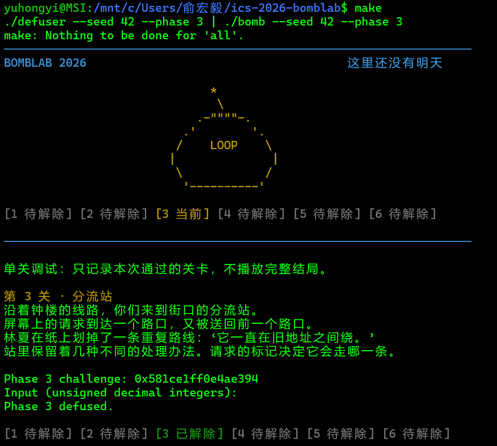

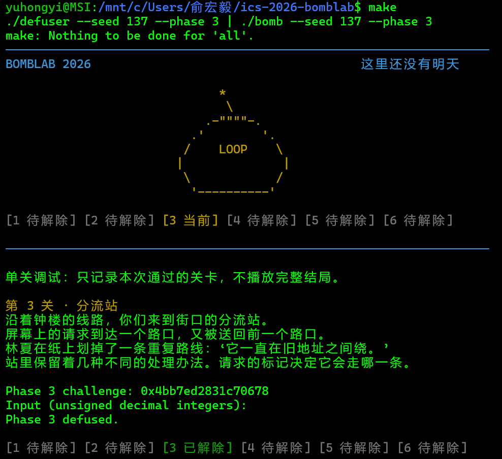

**推理：**

```asm
1.  40225a:	mov    %rsi,%r12    //challenge存入r12
    40225d:	mov    $0x2,%esi
    402263:	mov    %rdi,%rbx    //*out存入rbx
2.  40229c:	mov    %r12d,%edi
    4022a1:	and    $0x7,%edi
    //uint32_t idx = (uint32_t)challenge & 0x7u;    存入edi
    4022a9:	mov    %r12,%rax
    4022ac:	mov    %r12,%rsi
    4022af:	shr    $0x3,%rax
    4022b3:	shr    $0x20,%rsi
    4022b7:	xor    %eax,%esi
    //uint32_t arg = (uint32_t)(challenge >> 32) ^ (uint32_t)(challenge >> 3);  存入esi
3.  p3_dispatch:
    4021fd <+13>:    notrack jmp *0x4057e0(,%rax,8) //跳转表
    
    (gdb) x/8gx 0x4057e0
        0x4057e0:       0x0000000000402218      0x0000000000402220
        0x4057f0:       0x0000000000402228      0x0000000000402230
        0x405800:       0x0000000000402238      0x0000000000402240
        0x405810:       0x0000000000402208      0x0000000000402210
    //通过“x/8gx 0x4057e0”找到中转跳板的地址
    
    case_0:402218--"0x0000000000402218 <+40>:    jmp    0x402170"
        0x0000000000402170 <p3_case_2+0>:    endbr64
        0x0000000000402174 <p3_case_2+4>:    lea    0x40d9(%rdi,%rdi,2),%eax
        0x000000000040217b <p3_case_2+11>:   ret
    //3 * arg + 0x40d9

    case_1:402220--"0x0000000000402220 <+48>:    jmp    0x402130"
        0x0000000000402130 <p3_case_0+0>:    endbr64
        0x0000000000402134 <p3_case_0+4>:    mov    %edi,%eax
        0x0000000000402136 <p3_case_0+6>:    shr    $0x2,%edi
        0x0000000000402139 <p3_case_0+9>:    xor    $0xf18d,%eax
        0x000000000040213e <p3_case_0+14>:   add    %edi,%eax
        0x0000000000402140 <p3_case_0+16>:   ret
    //(arg ^ 0xf18d) + (arg >> 2)

    case_2:402228--"0x0000000000402228 <+56>:    jmp    0x4021d0"
        0x00000000004021d0 <p3_case_7+0>:    endbr64
        0x00000000004021d4 <p3_case_7+4>:    mov    %edi,%eax
        0x00000000004021d6 <p3_case_7+6>:    shr    $0x2,%edi
        0x00000000004021d9 <p3_case_7+9>:    xor    $0xc319,%eax
        0x00000000004021de <p3_case_7+14>:   add    %edi,%eax
        0x00000000004021e0 <p3_case_7+16>:   ret
    //(arg ^ 0xc319) + (arg >> 2)

    case_3:402230--"0x0000000000402230 <+64>:    jmp    0x4021c0"
        0x00000000004021c0 <p3_case_6+0>:    endbr64
        0x00000000004021c4 <p3_case_6+4>:    lea    0x45119(%rdi,%rdi,4),%eax
        0x00000000004021cb <p3_case_6+11>:   ret
    //5 * arg + 0x45119u

    case_4:402238--"0x0000000000402238 <+72>:    jmp    0x402180"
        0x0000000000402180 <p3_case_3+0>:    endbr64
        0x0000000000402184 <p3_case_3+4>:    lea    0x11ec2(%rdi,%rdi,4),%eax
        0x000000000040218b <p3_case_3+11>:   ret
    //5 * arg + 0x11ec2u
    
    case_5:402240--"0x0000000000402240 <+80>:    jmp    0x402150"
        0x0000000000402150 <p3_case_1+0>:    endbr64
        0x0000000000402154 <p3_case_1+4>:    lea    0x0(,%rdi,4),%eax
        0x000000000040215b <p3_case_1+11>:   xor    $0x4c30,%eax
        0x0000000000402160 <p3_case_1+16>:   ret
    //(4 * arg) ^ 0x4c30u
    
    case_6:402208--"0x0000000000402208 <+24>:    jmp    0x402190"
        0x0000000000402190 <p3_case_4+0>:    endbr64
        0x0000000000402194 <p3_case_4+4>:    lea    0x0(,%rdi,4),%eax
        0x000000000040219b <p3_case_4+11>:   xor    $0xb98f,%eax
        0x00000000004021a0 <p3_case_4+16>:   ret
    //(4 * arg) ^ 0xb98fu
    
    case_7:402210--"0x0000000000402210 <+32>:    jmp    0x4021b0"
        0x00000000004021b0 <p3_case_5+0>:    endbr64
        0x00000000004021b4 <p3_case_5+4>:    lea    0xcdf8(%rdi,%rdi,4),%eax
        0x00000000004021bb <p3_case_5+11>:   ret
    //5 * arg + 0xcdf8u
```

---

## Phase 4

**运行结果：**

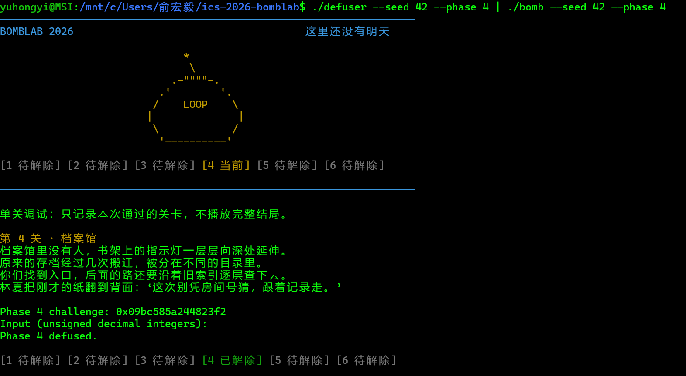

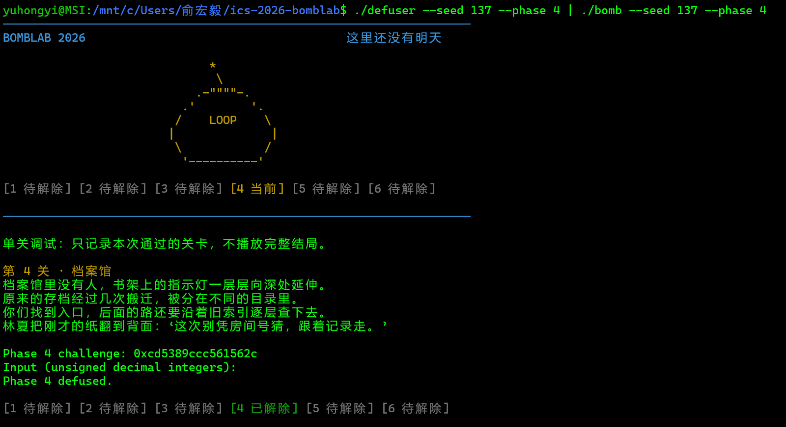

**推理：**

```asm
1.  challenge--r12,*out--rbx
2.  402388:	mov    %r12,%rcx
    40238b:	mov    %r12,%rax
    40238e:	mov    %r12d,%edi
    402391:	xor    %esi,%esi
    402393:	shr    $0x20,%rax
    402397:	shr    $0x7,%rcx
    40239b:	and    $0x7f,%edi
    40239e:	mov    $0x7f,%edx
    4023a3:	xor    %eax,%ecx
    //对应defuser.c中--(edi)a = (uint32_t)challenge & 0x7fu;(esi)b=0;(edx)c=0x7f;(ecx)d = (uint32_t)(challenge >> 7u) ^ (uint32_t)(challenge >> 32u);

3.  p4_walk:
    4022d0 <+0>:     endbr64
    4022d4 <+4>:     mov    %edi,%eax   //eax=a
    4022d6 <+6>:     mov    %edx,%edi   //edi=c
    4022d8 <+8>:     sub    %esi,%edi   //edi=c-b
    4022da <+10>:    shr    $1,%edi     //edi=(c-b)/2
    4022dc <+12>:    add    %esi,%edi   //edi=b+(c-b)/2，即中间值mid
    4022de <+14>:    cmp    %eax,%edi   //比较a和mid
    4022e0 <+16>:    je     0x402330 <p4_walk+96>   //a==mid则跳至402330结束
    4022e2 <+18>:    push   %rbp
    4022e3 <+19>:    mov    %rsp,%rbp
    4022e6 <+22>:    push   %rbx
    4022e7 <+23>:    lea    (%rdi,%rcx,1),%ebx  //ebx=mid+d
    4022ea <+26>:    sub    $0x8,%rsp
    4022ee <+30>:    cmp    %edi,%eax
    4022f0 <+32>:    jb     0x402310 <p4_walk+64>   //a>mid继续，a<mid走402310
    //a>mid分支
    4022f2 <+34>:    lea    0x1(%rdi),%esi          //esi=mid+1新区间下界，更新b
    4022f5 <+37>:    mov    %eax,%edi               //edi=a
    4022f7 <+39>:    call   0x4022d0 <p4_walk>      //递归p4_walk(a,mid+1,c,d)
    4022fc <+44>:    lea    (%rax,%rax,2),%eax      //eax=3*返回值
    4022ff <+47>:    xor    %ebx,%eax               //eax^=(mid+d)
    402301 <+49>:    mov    -0x8(%rbp),%rbx
    402305 <+53>:    leave
    402306 <+54>:    xor    $0x9,%eax               //eax^=0x9
    //对应defuser.c中return (3u * p4_walk(a, mid + 1u, c, d)) ^ v ^ 0x9u;
    402309 <+57>:    ret
    //a<mid分支
    40230a <+58>:    nopw   0x0(%rax,%rax,1)
    402310 <+64>:    lea    -0x1(%rdi),%edx         //edx = mid−1新区间上界，更新c
    402313 <+67>:    mov    %eax,%edi               //edi=a
    402315 <+69>:    call   0x4022d0 <p4_walk>      //递归p4_walk(a,b,mid-1,d)
    40231a <+74>:    lea    (%rax,%rax,2),%eax      //eax=3*返回值
    40231d <+77>:    xor    %ebx,%eax               //eax^=(mid+d)
    40231f <+79>:    mov    -0x8(%rbp),%rbx
    402323 <+83>:    leave
    402324 <+84>:    xor    $0x10,%eax              //eax^=0x10
    //对应defuser,c中return (3u * p4_walk(a, b, mid - 1u, d)) ^ v ^ 0x10u;
    402327 <+87>:    ret
    //a==mid分支
    402328 <+88>:    nopl   0x0(%rax,%rax,1)
    402330 <+96>:    lea    0xee(%rdi),%eax         //eax=mid+0xee(238)
    402336 <+102>:   xor    %ecx,%eax               //eax=(mid_238)^d
    //对应defuser.c中return (mid + 0xeeu) ^ d;
    402338 <+104>:   ret
```

---

## Phase 5

**运行结果：**

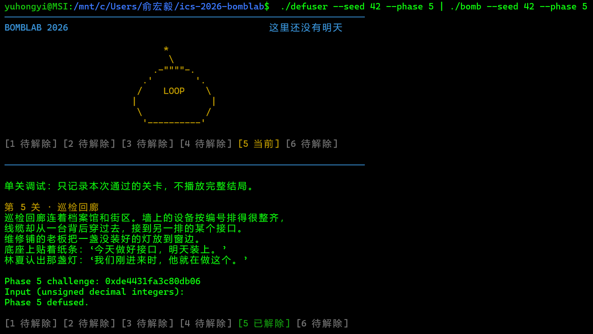

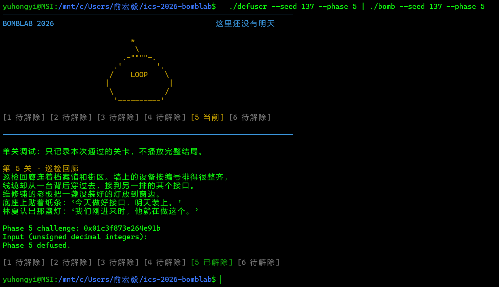

**推理：**

```asm
1.  challenge--r12,rdi,*out--rbx
2.  p5_traverse:
    4023c4 <+4>:     mov    %rdi,%rax   //rax=challenge
    4023c7 <+7>:     mov    %rdi,%rcx   //rcx=challenge
    4023ca <+10>:    mov    %rsi,%r8    //r8=*out
    4023cd <+13>:    and    $0x7,%eax   //eax=challenge&7
    4023d0 <+16>:    shr    $0x3,%rcx   //rcx=challenge>>3
    4023d4 <+20>:    mov    0x405b20(,%rax,8),%rdx
                                        //rdx=查表 0x405b20+8*rax
3.  4023dc <+28>:    mov    %rdi,%rax   //rax=challenge重新输入
    4023df <+31>:    shr    $0x20,%rdi  //rdi=challenge>>32,hi--edi=(uint32_t)(challenge >> 32);
    4023e3 <+35>:    shr    $0x6,%rax       //rax=challenge>>6
    4023e7 <+39>:    xor    %edi,%eax       //eax=((uint32_t)(challenge >> 6)) ^ hi
    4023e9 <+41>:    mov    0x4(%rdx),%esi  //esi = *(rdx+4)
    4023ec <+44>:    mov    %ecx,%edi       //edi=(challenge>>3)
    4023ee <+46>:    xor    $0x3046,%eax    //eax^=0x3046
    4023f3 <+51>:    add    (%rdx),%eax     //eax+=*(rdx)
    4023f5 <+53>:    lea    (%rax,%rax,4),%eax  //eax*=5
    4023f8 <+56>:    mov    %esi,(%r8)      //*r8=esi=*(rdx+4)
    4023fb <+59>:    xor    %esi,%eax       //eax^=esi
    4023fd <+61>:    and    $0x3,%edi       //edi&=3
    402400 <+64>:    je     0x40241f <p5_traverse+95>   //若edi==0跳到返回
    //以上即为:
    uint32_t low = (uint32_t)challenge;          
    uint32_t hi  = (uint32_t)(challenge >> 32);  
    int idx = low & 7;                                  //选起点
    int k   = (int)(((uint32_t)(challenge >> 3)) & 3u); //额外走 k 步，在edi
    uint32_t acc = (((uint32_t)(challenge >> 6)) ^ hi) ^ 0x3046u;   
    acc = (acc + node_val[idx]) * 5u;
    acc ^= node_out[idx];                               //在eax

4.  //循环
    402402 <+66>:    mov    $0x1,%ecx   //ecx = 1（循环计数器从1开始）
    402407 <+71>:    mov    0x8(%rdx),%rdx  //rdx = *(rdx+8)（取出链表下一个节点的指针）
    40240b <+75>:    add    $0x1,%ecx       //ecx+=1（计数器加1）
    40240e <+78>:    mov    0x4(%rdx),%esi  //esi = *(rdx+4)（新节点第2个成员）
    402411 <+81>:    add    (%rdx),%eax     //eax+=*(rdx)（加上新节点第1个成员）
    402413 <+83>:    lea    (%rax,%rax,4),%eax  //eax*=5
    402416 <+86>:    mov    %esi,(%r8)      //*r8 = esi
    402419 <+89>:    xor    %esi,%eax       //eax^=esi
    40241b <+91>:    cmp    %ecx,%edi       //比较 ecx 与 edi
    40241d <+93>:    jae    0x402407 <p5_traverse+71>   //若 ecx ≤ edi（无符号，即循环未结束）则回到循环体
    40241f <+95>:    ret
5.  回到phase_05:
    402478:	mov    %eax,%edx                //p5_traverse返回值存入edx
    40247a:	xor    %eax,%eax                //eax=0
    40247c:	cmp    %edx,-0x1c(%rbp)         //比较局部变量(rbp-0x1c，即第一个整数)与 edx
    40247f:	jne    402445 <phase_05+0x25>   //若不相等则跳到 0x402445 返回0
    402481:	mov    -0x14(%rbp),%eax         //eax = 局部变量(rbp-0x14)（p5_traverse 写回的值）
    402484:	cmp    %eax,-0x18(%rbp)         //比较局部变量(rbp-0x18，即第二个整数)与 eax
    402487:	sete   %al
    40248a:	jmp    402445 <phase_05+0x25>
```

---

## Phase 6

**运行结果：**

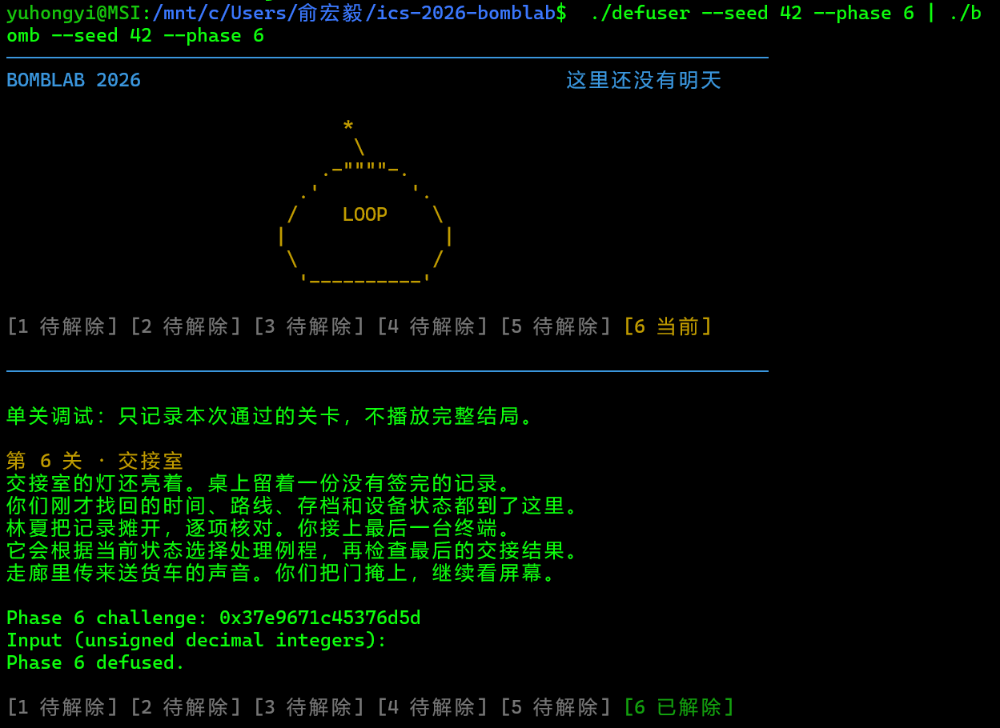

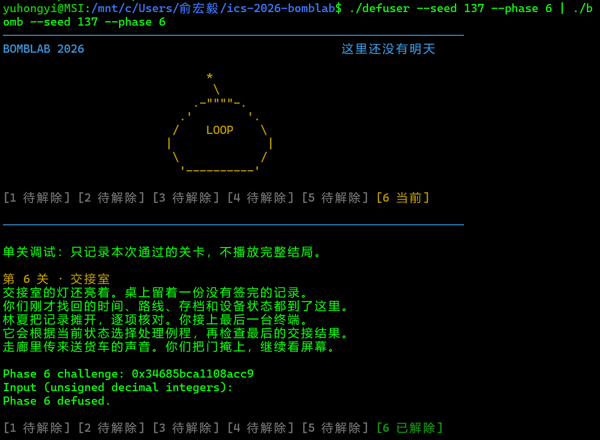

**推理：**

```asm
1.  rsi,r12--challenge,esi--1,rdi,rbx--*out
    随后"4025a8:	mov    %r12,%rdi"   rdi--challenge
2.  p6_dispatch:
    402519 <+9>:     mov    %rdi,%rbx           //(rbx=rdi)challenge
    40251c <+12>:    shr    $0x6,%rdi           //(rdi)challenge>>6
    402520 <+16>:    mov    %rbx,%rax           //(rax)challenge
    402523 <+19>:    shr    $0x20,%rax          //(rax)challenge>>32
    402527 <+23>:    xor    %eax,%edi           //(edi)(challenge>>6)低32位 ^ challenge高32位“记为arg1”
    402529 <+25>:    mov    %rbx,%rax           //(rax)原始challenge
    402530 <+32>:    and    $0x38,%ebx          //(ebx)challenge低32位&0x38
    402533 <+35>:    and    $0x7,%eax           //(eax)challenge低32位&0x7“记为idx1”
    402536 <+38>:    call   *0x405dc0(,%rax,8)  
    //调用函数，根据idx1，地址为0x405dc0+8*idx1
    40253d <+45>:    xor    $0x43d4,%eax        //(eax)返回值1“记为res1”^0x43d4
    402542 <+50>:    mov    %eax,%edi           //(edi)返回值1“记为res1”^0x43d4“记为mid”
    402544 <+52>:    call   *0x405dc0(%rbx)     
    //调用函数，由于没有*8，所以idx2=((uint32_t)challenge & 0x38u) >> 3;
    40254f <+63>:    add    $0xa7f0,%eax        //(eax)返回值2“记为res2”+0xa7f0
    402554 <+68>:    ret
3.  通过“x/8gx 0x405dc0”找到8个函数指针的真实入口地址
    (gdb) x/8gx 0x405dc0
    0x405dc0 <p6_ops>:      0x00000000004024a0      0x0000000000402500
    0x405dd0 <p6_ops+16>:   0x0000000000402500      0x00000000004024f0
    0x405de0 <p6_ops+32>:   0x0000000000402490      0x0000000000402500
    0x405df0 <p6_ops+48>:   0x00000000004024d0      0x00000000004024c0

    (gdb) disas 0x4024a0
    Dump of assembler code for function p6_op_1:
        0x00000000004024a0 <+0>:     endbr64
        0x00000000004024a4 <+4>:     mov    %edi,%eax
        0x00000000004024a6 <+6>:     shr    $0x7,%eax
        0x00000000004024a9 <+9>:     xor    %edi,%eax
        0x00000000004024ab <+11>:    add    $0x8d84,%eax
        0x00000000004024b0 <+16>:    ret
    End of assembler dump.
    //case 0:  res1 = (arg1 ^ (arg1 >> 7)) + 0x8d84u;
    (gdb) disas 0x402500
    Dump of assembler code for function p6_op_5:
        0x0000000000402500 <+0>:     endbr64
        0x0000000000402504 <+4>:     mov    %edi,%eax
        0x0000000000402506 <+6>:     rol    $0x2,%eax
        0x0000000000402509 <+9>:     xor    $0xe563,%eax
        0x000000000040250e <+14>:    ret
    End of assembler dump.
    //case 1/2/5:  res1 = ((arg1 << 2) | (arg1 >> 30)) ^ 0xe563u;
    (gdb) disas 0x4024f0
    Dump of assembler code for function p6_op_4:
        0x00000000004024f0 <+0>:     endbr64
        0x00000000004024f4 <+4>:     mov    %edi,%eax
        0x00000000004024f6 <+6>:     xor    $0xb5d6,%eax
        0x00000000004024fb <+11>:    lea    (%rax,%rdi,8),%eax
        0x00000000004024fe <+14>:    ret
    End of assembler dump.
    //case 3:  res1 = (arg1 ^ 0xb5d6u) + 8u * arg1;
    (gdb) disas 0x402490
    Dump of assembler code for function p6_op_0:
        0x0000000000402490 <+0>:     endbr64
        0x0000000000402494 <+4>:     lea    0xc38d(%rdi),%eax
        0x000000000040249a <+10>:    shr    $0x2,%edi
        0x000000000040249d <+13>:    xor    %edi,%eax
        0x000000000040249f <+15>:    ret
    End of assembler dump.
    //case 4:  res1 = (arg1 + 0xc38du) ^ (arg1 >> 2);
    (gdb) disas 0x4024d0
    Dump of assembler code for function p6_op_3:
        0x00000000004024d0 <+0>:     endbr64
        0x00000000004024d4 <+4>:     lea    0x0(,%rdi,8),%edx
        0x00000000004024db <+11>:    lea    0xd850(,%rdi,4),%eax
        0x00000000004024e2 <+18>:    sub    %edi,%edx
        0x00000000004024e4 <+20>:    xor    %edx,%eax
        0x00000000004024e6 <+22>:    ret
    End of assembler dump.
    //case 6:  res2 = (4u * mid + 0xd850u) ^ (7u * mid);
    (gdb) disas 0x4024c0
    Dump of assembler code for function p6_op_2:
        0x00000000004024c0 <+0>:     endbr64
        0x00000000004024c4 <+4>:     mov    %edi,%eax
        0x00000000004024c6 <+6>:     ror    $0x7,%eax
        0x00000000004024c9 <+9>:     ret
    End of assembler dump.
    //case 7:  res2 = (mid >> 7) | (mid << 25);
```

---

## Solve Secret

**运行结果：**


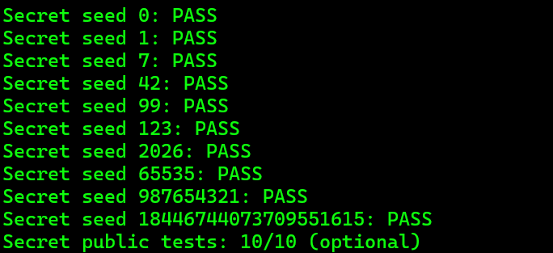

**推理：**

```asm
1.  secret_gate:
    4026cf:	push   %r14
    4026d1:	mov    %rdx,%r14            //(r14)context
    4026d4:	push   %r13                 
    4026d6:	mov    %rsi,%r13            //(r13)challenge
    4026d9:	push   %r12
    4026db:	lea    -0xd0(%rbp),%r12     //r12 = 栈缓冲区起始地址（rbp-208）
    4026e2:	push   %rbx
    4026e3:	mov    %rdi,%rbx            //(rbx)*out
    4026e6:	mov    %r12,%rdi            //rdi = 缓冲区起始地址，准备做清零
    4026e9:	sub    $0xb0,%rsp   
    4026f0:	rep stos %rax,%es:(%rdi)    //循环20次，每次写8字节的0，把缓冲区清零（共20*8=160字节）
    4026f3:	movl   $0x0,(%rdi)          
    4026f9:	mov    %rbx,%rdi            //(rdi)输入字符串out，准备算长度
    4026fc:	call   401190 <strlen@plt>  //调用strlen，总长度存在 rax
    402701:	sub    $0x24,%rax           //(rax)总长度 - 36
    402705:	cmp    $0x7f,%rax           //比较：长度-36 和 127
    402709:	jbe    402720 <secret_gate+0x60>    //合法则跳转到继续校验
    ///
    40270b:	add    $0xb0,%rsp
    402712:	xor    %eax,%eax
    402714:	pop    %rbx
    402715:	pop    %r12
    402717:	pop    %r13
    402719:	pop    %r14
    40271b:	pop    %rbp
    40271c:	ret
    40271d:	nopl   (%rax)
    ///长度不合法，失败
    402720:	mov    %rbx,%rsi            //(rsi)out,源地址 = 输入字符串
    402723:	mov    %r12,%rdi            //目的地址 = 栈缓冲区
    402726:	call   4026a0 <secret_copy> //调用secret_copy
    40272b:	cmpl   $0x4e45504f,-0xb0(%rbp)  //检查缓冲区第32字节处的4字节
    402735:	jne    40270b <secret_gate+0x4b>    //不等于OPEN则失败
    402737:	mov    %r14,%rdx            //(rdx)context
    40273a:	mov    %r13,%rsi            //(rsi)challenge
    40273d:	lea    -0xac(%rbp),%rdi     //(rdi)缓冲区第36字节开始的位置
    402744:	call   4025e0 <secret_phase>    //调用secret_phase
    402749:	add    $0xb0,%rsp
    402750:	pop    %rbx
    402751:	pop    %r12
    402753:	pop    %r13
    402755:	pop    %r14
    402757:	pop    %rbp
    402758:	ret
2.  secret_copy://把外部输入完整拷贝到栈上内部缓冲区。
    4026a4:	xor    %eax,%eax    //eax=0，作为循环下标i
    4026a6:	cs nopw 0x0(%rax,%rax,1) //内存对齐填充，无功能
    4026b0:	movzbl (%rsi,%rax,1),%edx //读源字符串第i字节，零扩展到32位
    4026b4:	mov    %dl,(%rdi,%rax,1)  //写入目标缓冲区第i字节
    4026b7:	add    $0x1,%rax          //i++
    4026bb:	test   %dl,%dl            //检查当前字节是不是'\0'
    4026bd:	jne    4026b0             //不是结束符就继续循环
    4026bf:	ret                       //拷贝完成，返回
3.  secret_phase:
    4025e0:	endbr64
    4025e4:	push   %rbp
    4025e5:	mov    %rsp,%rbp            
    4025e8:	push   %r13                 
    4025ea:	mov    %rdx,%r13            //(r13)context
    4025ed:	push   %r12                 
    4025ef:	mov    %rsi,%r12            //(r12)challenge
    4025f2:	mov    $0x3,%esi            //期望3个字段
    4025f7:	push   %rbx
    4025f8:	mov    %rdi,%rbx            //(rbx)*out
    4025fb:	sub    $0x18,%rsp
    4025ff:	call   402c10 <valid_u32_fields>
    402604:	test   %al,%al
    402606:	jne    402620 <secret_phase+0x40>
    402608:	xor    %edx,%edx
    40260a:	add    $0x18,%rsp          
    40260e:	mov    %edx,%eax            
    402610:	pop    %rbx
    402611:	pop    %r12
    402613:	pop    %r13
    402615:	pop    %rbp
    402616:	ret
    402617:	nopw   0x0(%rax,%rax,1)
    402620:	xor    %eax,%eax
    402622:	lea    -0x24(%rbp),%r8
    402626:	lea    -0x28(%rbp),%rcx
    40262a:	mov    $0x40317c,%esi
    40262f:	lea    -0x2c(%rbp),%rdx
    402633:	mov    %rbx,%rdi
    402636:	call   4011e0 <__isoc99_sscanf@plt>
    40263b:	cmp    $0x3,%eax
    40263e:	jne    402608 <secret_phase+0x28>
    //校验第一个整数x
    402640:	mov    %r13d,%ecx           //(ecx)context低32位
    402643:	xor    %edx,%edx
    402645:	and    $0x3,%ecx            //(ecx)context低32位&0x3
    402648:	cmp    %ecx,-0x2c(%rbp)     //和输入的x比较
    40264b:	jne    40260a <secret_phase+0x2a>   //不等则失败
    //准备计算第二个整数y
    40264d:	mov    %r12,%rsi            //(rsi)challenge
    402650:	imul   $0xbb45,%ecx,%r9d    //(r9d)x*0xbb45
    402657:	mov    %r13,%r8             //(r8)context
    40265a:	shr    $0x20,%rsi           //(rsi)ch_high=challenge高32位
    40265e:	shr    $0x20,%r8            //(r8)ctx_high=context高32位
    402662:	xor    %r12d,%esi           //(esi)ch_xor=challenge_high ^ challenge_low
    402665:	xor    %r13d,%r8d           //(r8d)ctx_xor=context_high ^ context_low
    402668:	shr    $0x10,%r13           //(r13)context >> 16
    40266c:	mov    %esi,%edi            //(edi)ch_xor（secret_mix输入）
    40266e:	xor    %r13d,%r9d           //r9d ^= (context>>16)
    402671:	xor    %r8d,%edi            //(edi)ch_xor ^ ctx_xor（mix_in）
    402674:	call   4025c0 <secret_mix>  //调用secret_mix
    //mix返回，继续校验y
    402679:	xor    %r9d,%eax            //(eax)y=mix返回值rol ^ r9d
    40267c:	cmp    %eax,-0x28(%rbp)     //和输入的y比较
    40267f:	jne    40260a <secret_phase+0x2a>   //不等则失败
    //校验第三个整数z
    402681:	shr    $0x3,%esi            //(esi)ch_xor >> 3
    402684:	lea    0xb3c5(%r8,%rcx,1),%edx  //(edx)ctx_xor + x + 0xb3c5
    40268c:	add    %esi,%edx            //edx += (ch_xor >> 3)→offset
    40268e:	xor    %edx,%eax            //(eax)z=y ^ offset
    402690:	cmp    -0x24(%rbp),%eax     //和输入的z比较
    402693:	sete   %dl                  //相等则dl=1，否则0
    402696:	jmp    40260a <secret_phase+0x2a>
4.  secret_mix:
    4025c0:	endbr64
    4025c4:	mov    %edi,%eax            //(eax)输入参数
    4025c6:	rol    $0x3,%eax            //eax 循环左移 3 位
    4025c9:	add    $0xbb45,%eax         //(eax)rol += 0xbb45u
    4025ce:	xor    $0xb3c5,%eax         //(eax)rol ^= 0xb3c5u
    4025d3:	ret
```

---

课程辅助工具AI用途：翻译部分汇编代码的意思，纠正defuser.c填写错误
